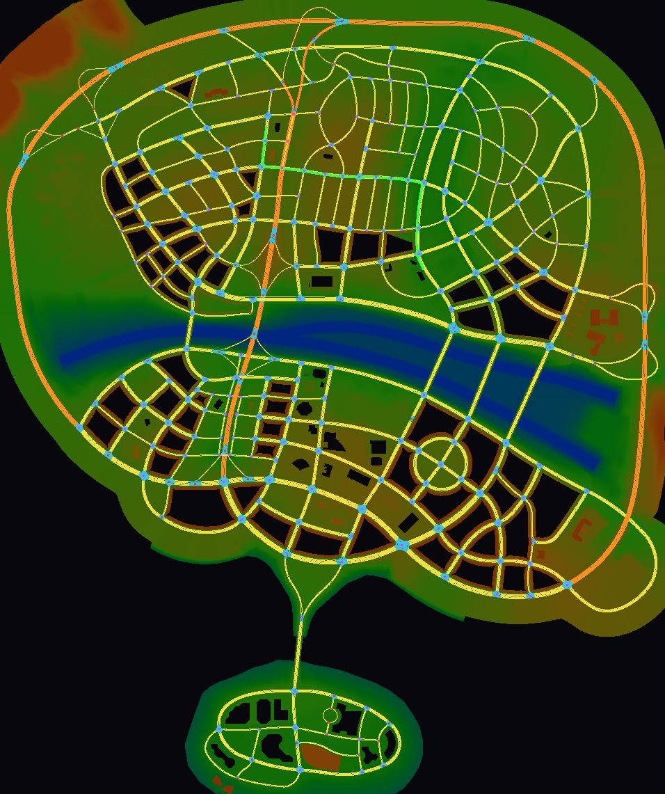

# Gaps wave: roads (`src/Slrr.Roads`)

The AI road graph (`.trc`), the `.spl` race lines, a queryable road graph for the map natives and AI drivers, the
road-native adapter, the `roads` CLI, and the root cause + fix of "no ground" in Valo City / City. Labels: **MEASURED** =
static exe disassembly (StreetLegal_Redline.exe, never executed) or a check over the shipped data; **GUESSED** = chosen, not
traced. Nothing here is compared with the running original game; no parity is claimed.

```
dotnet test src/Slrr.Roads/Slrr.Roads.sln -warnaserror       # 17 tests (corpus tests pass vacuously without game data)
roads stats|verify maps/city.rpk --root .                     # after integration: dotnet run --project tools/Slrr.Cli -- roads ...
roads map maps/city.rpk roads.png --height --route -278.5 9.8 1033 355.4 1.6 418.2
roads route maps/city.rpk x1 y1 z1 x2 y2 z2 | align | cross | dump | spl | bench
```

| File | Contents |
|---|---|
| `TrcFile.cs` | `.trc` reader/writer (`TrcFile`, `TrcNode`, `TrcConnector`, `TrcRoad`, `TrcLane`, `HermitePiece`); format in docs/formats/trc.md |
| `RoadCurve.cs` | `RoadCurve` (piece chain: point / unit tangent / signed curvature / x-z projection), `IRoadPath`, `PathSample` |
| `RoadGraph.cs` | `IRoadGraph`, `RoadGraph` (crossings, roads, lanes, turn paths; queries; lane routing), `RoadRoute`, `RouteLeg`, `LaneHit` |
| `RoadGraphCatalog.cs` | finds a map's `.trc` (root RSD `params`), caches graphs |
| `SplineFile.cs` | `.spl` parser + Catmull-Rom path (`IRoadPath`) |
| `RoadNativesModule.cs` | `INativeModule` for the road natives, `NavigatorState` |
| `RoadMapImage.cs` | PNG/SVG top-down picture over a `HeightMap` |
| `tools/Slrr.Cli/CmdRoads.cs` | `roads` CLI (compiled by the test project until wired) |

## 1. Road data in the repository (MEASURED, file scan + exe)

* `maps/city/ai/city.trc` is the only `.trc`; city.rpk's root names it (`params ...,maps\city\meshes\city.scm,maps\city\ai\city.trc`).
  Format fully decoded (docs/formats/trc.md): 271 crossings (53 + 218), 484 roads, 1572 lanes, 3854 turn paths, 10,765 cubic
  Hermite pieces; parses to the last byte, rewrites byte-identically, 13 structural checks hold on every record (`roads verify`).
* `.spl` race lines: maps/ROC_track/race.spl (52 points, closed 4.2 km loop), maps/test_track/test.spl (2 points, 4 km
  straight), cars/racers/ROC_cars/ROC_*.spl (7 x 57 points, closed). Fed to `AI_spline` by `Bot.followSplineTrack` in ROC races;
  columns after x y z are GUESSED (`SplineFile` doc).
* No map other than city/Valo City has a road graph: the track-selector maps keep MapNatives' collision-ground answers.



`roads-city.png` (`roads map maps/city.rpk ... --cell 3 --height --route garage0 garage1`): the collision ground of city.rpk
**+ city2.rpk** (height-coloured, black = no PHYS ground, i.e. buildings), lanes (yellow = 13.9 m/s, orange = 27.8 m/s: the
ring motorway), turn paths (cyan), crossings (red table A, magenta table B), the route between Valo City garages 0 and 1
(green, 1235 m). Every lane sits on drivable ground: 22,905 lane samples (every 10 m), ground found under all, median |dy|
0.000 m, p90 0.004 m, all within 0.5 m (test `LanesLieOnTheMergedCityGround`).

## 2. Queries (`IRoadGraph`) and what they are based on

| Query | Behaviour | Label |
|---|---|---|
| `NearestLane(p)` | lanes whose x range lies within 20 m of p.x, closest x/z curve point, dropped if \|dy\| ≥ 5 m, min 3-D distance | structure + constants 20.0 (0x5f0c4c) / 5.0 (0x5f45c8) MEASURED (0x581bf0); per-piece closest point ours |
| `AlignToRoad(p)` (`alignToRoad`) | nearest lane → its ROAD curve; point at the x/z projection; unit tangent, negated when the projection is past half the road (faces the farther end) | MEASURED (0x483e60 → 0x583a00, 0.5 at 0x5f09d0) |
| `NearestCross(p, d)` (`getNearestCross`) | crossing minimising \|‖pos − p‖ − d\|; the native passes no level filter | MEASURED (0x483d00 → 0x581a00) |
| `StartDirection(a, b)` (`getStartDirection`) | unit tangent of the route at a; null without a route | tangent use MEASURED (0x583840), route GUESSED |
| `FindRoute(a, b[, heading])`, `RouteLength` (`getRouteLength`, `findRoute`) | Dijkstra over lanes + turn paths from any lane of the road nearest a (or lanes within 90° of `heading`) to any lane of the road nearest b; -1 when none | GUESSED (exe 0x5826f0 routes over road curves/crossings, not traced) |
| curve sampling | Hermite with u = s / pieceLength, normalised tangent, negative s wraps (exe); `Sample` clamps; signed x/z curvature | MEASURED mapping; curvature/clamp ours |
| speed | `Lane.SpeedLimit` 13.889 / 27.778 m/s | value MEASURED, meaning GUESSED |

Rates (one thread, `roads bench`, 20,000 points beside random lanes): nearest lane 25 µs, alignToRoad 18 µs, route 0.64 ms
(mean 1733 m). Parse + graph build of city.trc: the whole `roads dump` process takes 0.16 s.

## 3. Natives adapter (`RoadNativesModule`, replace semantics)

Registers `GroundRef.alignToRoad`, `getNearestCross(V,F)`, `getStartDirection`, `getRouteLength(V,V)`, exe-only `findRoute`,
`getRouteLength()`, `getRoutePos`, `getRouteDist` (names MEASURED 0x4898e4..; `findRoute` and `getRouteLength(V,V)` share
handler 0x483750), and `java.game.Navigator.updateNavigator(GameRef,I)V`. On a ground whose map names no `.trc`, every
GroundRef native calls the registration it replaced (MapNatives' ground answers). `updateNavigator` records the car, mode,
position and lane in `NavigatorState` (for a minimap) and then calls the previous registration.

**MEASURED run** (test `ValoCityEntersWithRoadNativesAndGroundUnderTheStart`: GameHost + MapNatives + this module, demo car,
TrackSelect → Valo City, 3 s): entered, 0 thread errors; posStart (-83.8, 12.9, -558.7) has ground 12.890; in the VM:
`alignToRoad` → (-75.73, 12.83, -534.85) dir (0.947, 0.016, -0.320); `getNearestCross(p, 500)` → crossing 502.9 m away;
`getStartDirection` → (-0.947, -0.017, 0.321); `getRouteLength` 636.7 m; `updateNavigator` 91 calls, car on lane 1461. Only
missing native: `Vehicle.getSpeedSquare` (the race host's physics area has it).

## 4. Valo City / City: no ground — root cause and fix (MEASURED)

* **Cause:** the city map is TWO archives. city.rpk's root node carries the only `EXTP` chunk of all shipped archives
  (payload u32 3); slot 3 of city.rpk's reference table is `maps\city2.rpk`. The exe's tree parser handles `EXTP`
  (0x53e0d6): for each u32 it calls 0x544370, which loads resource `slot << 16` of the reference table, and it grows the node's
  box by the attached tree's box. Slrr.World ignored EXTP, so `maps\city.rpk` gave only the southern half (z ≤ 329).
* **Evidence:** Valocity.posGarage = (-278.518, 9.8, 1033.002), (355.381, 1.6, 418.244), (-531.138, 5.05, -149.357); without
  the extension the first two have no ground; with it the ground is 9.812 / 1.602 / 5.061 (script y ± 1.2 cm), the first
  two on city2 surfaces. city.trc's lanes span z -1808..1553 = city ∪ city2 and lie on the merged ground (above). City
  (the career class) and Valocity (extends City) use the same ground `maps.city:0x0001r`.
* **Fix (Slrr.World, default on):** `WorldLoadOptions.FollowExtensions` loads every archive an EXTP names (recursively,
  each once) and merges its PHYS, objects and POLY into the world; each part's surface/material ids are shifted behind the
  previous parts' `.scm` (city 108 + city2 75 = 183 surfaces). New: `StaticWorld.Extensions` (`WorldExtension`),
  `PlacedObject.SourceArchive`, `WorldLoader.ExtensionSlots`, `RenderScene.Build(forests, table)`. Merging geometry is GUESSED
  from the exe's EXTP handling; how the exe streams the two halves is not traced.
* **After (race-play, MEASURED):** `race-play --track "Valo City" --seconds 5`: car at the garage (-278.6, 10.8, 1033.0),
  **wheels grounded 100 %** (was 0 %, free fall to y -163.7); 0 thread errors, 0 missing natives; the world build is now
  ~2.3 s (707,812 triangles, 25,821 objects; city alone 0.9 s). The car still does not move: a modal `DF_FREEZE` dialog is
  open (Valocity's garage trigger shows "This is a higher club's garage, you can't enter!" / "Go back to the garage?" when
  the car stands still in a garage trigger, which is where `posStart = posGarage[club]` puts it) and the throttle axis has no
  mapping in that state — a script/UI flow issue, not ground (GUESSED reading of Valocity.java ~l.230; not fixed here).

Changes outside the new projects: `src/Slrr.World/StaticWorld.cs`, `src/Slrr.World/RenderScene.cs` (above);
`tests/Slrr.World.Tests/CorpusTests.cs`: two city.rpk-only assertions (108 surfaces, 9,708 object boxes) now load with
`FollowExtensions = false`. All 27 Slrr.World tests pass.

## 5. Integration steps (lead)

1. `Slrr.sln`: add `src/Slrr.Roads/Slrr.Roads.csproj` and `tests/Slrr.Roads.Tests/Slrr.Roads.Tests.csproj`.
2. `tools/Slrr.Cli/Slrr.Cli.csproj`: `<ProjectReference Include="..\..\src\Slrr.Roads\Slrr.Roads.csproj" />`; `Commands.cs`:
   `"roads" => CmdRoads.Run(args[1..], o, e),` + usage `CmdRoads.Usage`. (`CmdRoads.cs` does not compile in Slrr.Cli before that.)
3. `Slrr.Race/RaceHost.cs` (and any host using MapNatives): right after the MapNatives factory add
   `factories.Add(_ => new RoadNativesModule(maps!.Maps, new RoadGraphCatalog(root)));` — after MapNatives (it wraps its
   road natives), before the render hooks; order relative to PhysicsNatives/CommandNatives does not matter
   (CommandNatives only fills `updateNavigator` when missing; our wrapper calls whatever was there).
4. Renderer minimap: read `RoadNativesModule.Navigator` (car position, lane) and draw `RoadGraph` lanes (see `RoadMapImage`).
5. AI driver (commands area): `IRoadGraph.FindRoute(from, to, heading)` → `RoadRoute.Sample(s)` gives position, unit
   tangent, signed curvature, speed value and lane id; `Project(p, out s, out lateral)` gives progress and lateral error.
   `SplineFile` gives the same `IRoadPath` for `AI_spline` files.
6. Render area: `RegionMapLoader` (Slrr.Render) reads `maps\city.rpk` itself and does not follow EXTP either, so the drawn
   Valo City lacks the northern half; use `StaticWorld.Render` / `WorldLoader.ExtensionSlots` there.
7. MapNatives `Instantiate` maps object gametypes through the city slot; city2 objects using slot 2 (objects.rpk) resolve the
   same, other slots should use `PlacedObject.SourceArchive` (not done: MapNatives is another area's file).

## Open questions

1. The exe's route builder (0x5826f0: roads, crossings, the 0.7 × crossing radius test at 0x583840) — our lane Dijkstra
   may pick different routes; `getRouteLength` with no route returns -1 (GUESSED).
2. Meaning of crossing table A/B, turn-path codes (signal phases?), speed value, ref88/ref8c, crossing tail (docs/formats/trc.md).
3. `.spl` columns and the `AI_spline` parser; ROC scripts read `save/cars/roc_XX.spl` while the files ship in cars/racers/ROC_cars/.
4. Traffic/pedestrians (`addTrafficN`, city.rest / city.walk) are still only recorded; the graph is ready for them.
5. Whether the exe loads city2.rpk wholly at map load or streams it (memory/time of the merged world: ~2.3 s build here).
