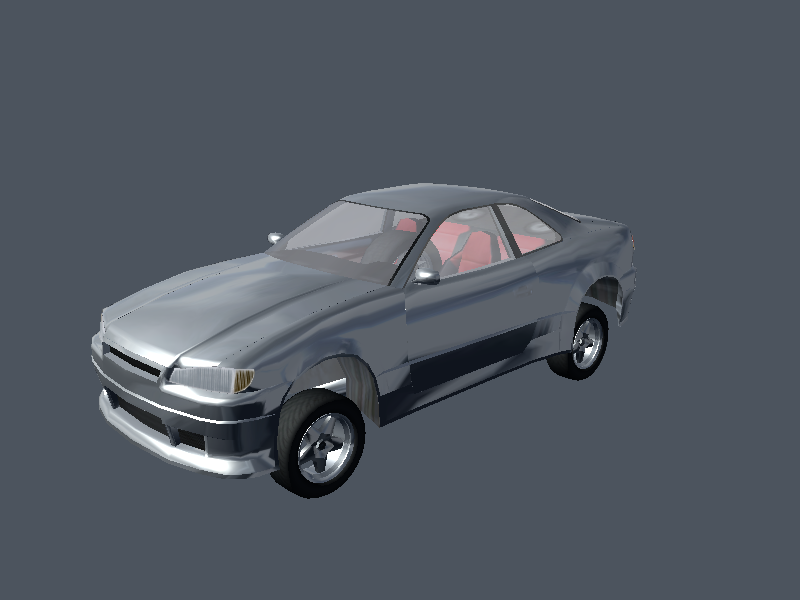
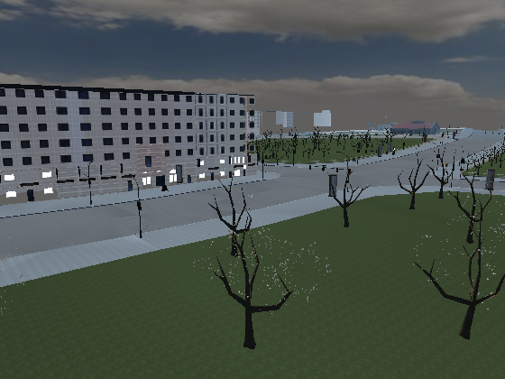
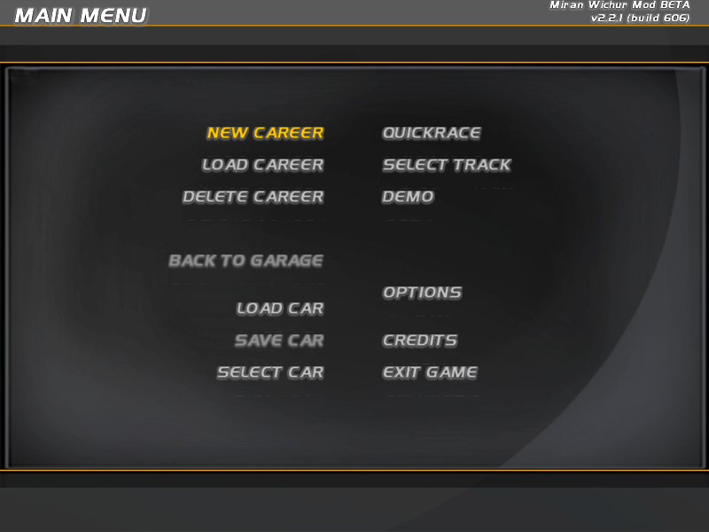

# Render area: game renderer on Silk.NET GL 3.3 (`src/Slrr.Render`)

Phase 4 area **Render**. It turns the Phase 2 viewer spike ([viewer.md](../viewer.md)) into a library that renders
textured, lit SCX meshes with their materials, assembled cars, map regions (POLY geometry and placed objects, instanced,
culled, LOD-selected, under a sky dome) and a 2D overlay fed by the headless UI state of `Slrr.Engine.Ui`. It renders
offscreen to PNG. Silk.NET is pinned at 2.22.0, and every GL call stays inside `Slrr.Render/Gl`.

Labels: **M** = measured on the shipped data or scripts, **G** = guessed (chosen to fit the data; needs a trace of the
original or a side-by-side screenshot).

Build and test in isolation:

```
dotnet build src/Slrr.Render/Render.sln -warnaserror
LIBGL_ALWAYS_SOFTWARE=1 xvfb-run -a dotnet test src/Slrr.Render/Render.sln   # 17 tests; GL/corpus tests pass vacuously without a display / game data
```

## CLI

`tools/Slrr.Cli/CmdRender.cs` exposes `public static int Run(string[] args, TextWriter o, TextWriter e)`.
**Integration:** `Slrr.Cli.csproj` needs a ProjectReference to `src/Slrr.Render`, and `Commands.cs` needs the line
`"render" => CmdRender.Run(args[1..], o, e)`. Neither change is made here. Until then the same file runs through
`src/Slrr.Render/Host` (`slrr-render`):

```
LIBGL_ALWAYS_SOFTWARE=1 xvfb-run -a dotnet src/Slrr.Render/Host/bin/Debug/net8.0/slrr-render.dll <command>
render car [car.rpk] [--car alias] [--rim cfg] [--tyre cfg] [--yaw r] [--pitch r]
render map [map.rpk] [--at x,z] [--radius r] [--eye x,y,z] [--look x,y,z] [--sky alias]
render ui [splash|menu] [--frames n]
common: [--root dir] [--out file.png] [--size WxH] [--repeat n] [--cull]
```

Each command prints the GL version, the scene counts, draw calls, the first-frame time (which includes uploads), the
steady-state frame times, peak memory, and any content problems. Exit codes: 0 ok, 1 not a game root, 2 usage, 3 no GL context.

## Files

| File | Role | GL |
|---|---|---|
| `Content/GameContent.cs` | Lazy archive cache, id resolution (local id or 1-based reference slot), entry text (unwraps inline `ICFG`), render entries -> mesh + texture paths, gametype cfgs (`native part/car x.cfg` or inline), texture and SCX caches; problems are collected, never thrown | no |
| `Content/CfgRenders.cs` | cfg -> `render`/`deformable` lines with transforms and `lod a b`, `lods n t..`, `slot` + `attach`, `wheel` + `type .. sphere r`, `stockpart` | no |
| `Geometry/MaterialDesc.cs`, `CpuMesh.cs` | SCX material -> base/decal/env stages, alpha mode; SCX or POLY -> interleaved vertices (pos, normal, uvA, uvB, rgba), untrusted input skipped and counted | no |
| `Geometry/MeshStats.cs` | Winding vs stored normals (settles culling) | no |
| `Scene/Camera.cs`, `Frustum.cs`, `SceneTypes.cs` | Camera, orbit and chase rigs, frustum planes and AABB transform, `LodSet`, `DrawItem`, `StaticChunk`, `SceneDescription`, `GameUnits` | no |
| `Cars/CarAssembler.cs` | Car cfg -> placed parts and draw items | no |
| `Maps/MapLoader.cs` | Map rpk -> POLY chunks + SCY materials, placed objects, sky | no |
| `Overlay/FontData.cs`, `OverlayModel.cs` | Glyph tables from the font SCX, overlay quads and texts, layout to pixel sprites | no |
| `Overlay/UiBridge.cs` | `RenderTap` (native wrapper module), `UiOverlaySource` (UiEngine + VM -> `OverlayFrame`) | no |
| `Gl/*` | `GlHost` (hidden GLFW window, 3.3 core), `GlProgram` + shaders, `GpuMesh` (VAO with per-instance mat4), `TextureCache`, `OffscreenTarget`, `GameRenderer`, `OffscreenRenderer` | yes |

## Conventions settled from data

| Fact | Evidence | Label |
|---|---|---|
| **SCX positions are centimetres**; cfg positions, instance boxes, POLY vertices and object params are metres. Meshes are drawn with `Scale(0.01)` | The 15" MT_Mescaline rim mesh has radius 19.05 (= 7.5 in x 2.54). Nonus `chassis.scx` is 410.4 long, while its wheel lines sit at z -1.351/+1.260. `lamp_base.scx` is 802 tall with a cfg render offset of y 4.01. After scaling, the assembled Nonus measures 1.74 x 1.50 x 4.23 m | M |
| **+Y is up** | Wheel centres at y -0.596/-0.616, and the tyre bottoms at y -0.92 are below the chassis mesh bottom at -0.609. Map POLY ground lies at y about 0..12 with objects standing on it | M |
| **Front is -Z, left is -X** | `F_bumper` slot z -2.042 and `R_bumper` +2.047. `L_*` slots, the LHD driver seat (`FL_seat` x -0.364), the driver camera (x -0.395) and the steering wheel (x -0.378) are all at -X. Headlight lights (`cars\racers.rpk` type 13) have `direction 0 0 -1` | M |
| Y up, front -Z, left -X is a right-handed frame, so drawing the data unmirrored in GL is correct | Follows from the three rows above. The mirrored alternative would put the driver of a European car on the right | M (inference) |
| **Winding**: the RH cross `(b-a)x(c-a)` agrees with the stored normals, so front faces are CCW in GL | Nonus car meshes: 22,489 agree / 0 disagree. City POLY: 198,564 / 10. Drag_Track: >99%. The `--cull` render is pixel-identical to the unculled one (car) and 30% faster. Culling stays off by default because foliage and glass may be authored single-sided (open question) | M |
| UV origin top-left (no V flip) | graphics.md overlay check. UI text renders upright with font glyph v growing with screen y | M |
| Fonts: a font is a render entry (type 14) whose mesh is a 256-quad v3 SCX (quad i = character code i, z = -100 i) plus a glyph atlas. 10 font units = 1 texel. Glyph y grows downwards on screen | `frontend\meshes\Fonts\*.scx` (1,024 vertices, 512 triangles each). sl14 'A' = x -20..80, y 0..220, uv (0.355,0.121)-(0.395,0.207) of a 256x256 atlas. The rendered menu text is upright and readable | M |
| `frontend\font.dat` = the 135 characters `!`..`0xA7` the atlases were cut from; `font_pointers.dat` = "ABCDEFGHIJKLMN" (symbol_pointers glyphs) | file contents | M (not needed for drawing) |
| Glyph advance = quad right edge (quads start 2 texels left of the pen) | Looks right for the SLII fonts | G |
| Text size: 1 texel = 1 pixel at `Config.video_x/y` (800x600), scaled to the target | | G |
| Object gametypes in objects.rpk store their cfg inline: `ICFG`, u32 length, NUL-separated text | lamp_base 0x18E (860 bytes, length 852) | M |
| cfg `render` lines may name lights (type 13 entries, e.g. headlights `type spot`); they are counted and not drawn | Nonus: 12 per car | M |
| A texture `sourcefile` that is not shipped resolves to the same name with another texture extension | frontend.rpk 0x16 (`Osd.RID_GENERALBG`, the main menu background) names `GPS_FrameRaceSetup.png`; only `gps_frameracesetup.ptx` ships, and the menu then renders correctly | G (engine rule) |
| Map materials: POLY `material` indexes the `.scy` next to the root's `.scm` (v3 SCX with materials only); textures come from the render entry whose mesh is that `.scy` | Drag_Track: `Ground.SCM` says `materials 18`, the SCY has 18 materials, render 0x4 has 20 textures. City has 108 materials, matching the POLY range 0..107 | M |
| Roots without an `.scm` (test_track `params 0x00000014`) use the archive's only render entry with a `.scy` mesh | gives 86 materials, 80 of them textured, and a plausible image | G |
| Sky: one render entry of `maps\skydome.rpk` (16 shipped), drawn eye-centred, unlit, without depth | the dome mesh is about 100 m across | M data / G usage |

## Materials and stages (G unless noted)

* Base = the lowest non-generated stage other than slot 1 (normally slot 0), multiplied by the diffuse colour (B,G,R,A bytes, graphics.md hypothesis).
* Slot 1 = decal/livery layer, blended over the base by its own alpha: `mix(base, decal, decal.a)`. Its UV channel goes in vertex attribute B.
* Slot 3 / uvSource -2 = reflection: sphere-mapped, added with strength from property 0x01000001 (0.25 if absent). An unassigned slot 3 uses the
  engine map `maps\skydome\envmaps\General_envMap2.dds`. The real choice is script-driven: MainMenu calls `GfxEngine.setGlobalEnvmap(maps.skydome:0x35)`.
* Stage scale/offset is applied as `uv * scale + offset`. Slots 2, 4 and 5 are ignored.
* Alpha mode: flags2 bit `0x40000000` means **blend**. That bit is set on 118 "window*" materials and 124 "*glow*"/OSD materials (correlation M,
  meaning G). A base texture with any alpha < 255 means **alpha test** at 0.5. Diffuse alpha < 0.99 also means blend. flags2 `0x80000000`/`0x20000000`
  (foliage, fences, "alphatest") are recorded but only matter through the texture alpha.
* v3 materials (maps, older parts) get no specular. Without this, the SCY specular 0.59 / power 27 left a large white glare on the ground.
* Lighting: one directional light plus ambient. The values are the frontend.rpk `sun` light (ambient 0.162/0.225/0.306, read as A,R,G,B), with the
  light direction tilted for the screenshots. Two-sided lighting is on (the normal is flipped towards the viewer) and linear fog is used on maps.
* POLY colour0 multiplies the base colour (byte order B,G,R,A guessed).

## Car assembly (`CarAssembler`)

`World(child) = Inverse(Slot(child mount)) * Slot(parent) * World(parent)` (row vectors). A slot matrix is `Ypr(a,b,c) * T(x,y,z)`,
with yaw about Y, pitch about X and roll about Z, composed roll, then pitch, then yaw (G order and signs, M meaning of the first
angle: right-wheel slots use `3.142 0 0`). The child's mount slot is the slot line that carries `attach <parent type> <parent slot>`
(M pairing: FL_door slot 5 / `attach 0x6 5` / car slot 5; tyre slot 1 / `attach 0x00020200 2` / rim slot 2). The fallback is any attach whose
slot id the parent has (G). Slots 101..104 after a `wheel` line are wheel-relative (G). Parts come from the car's `stockpart` list,
recursively. Wheels are not stock parts: the car scripts install them, and those scripts are not evaluated here. The caller therefore
picks a rim and tyre cfg (default `rim_Einvagen_GT_7_5_16`, `tyre_195_50_16`).

Nonus (`Emer_MotorSport_Nonus_GT_II`): 39 parts and 60 render items, 12 lights skipped. Tests check that the FL_door translation is
(-0.720, -0.101, -0.087) and that the right rims are mirrored outward.

## Interfaces for other areas

* `SceneDescription` (+ `DrawItem(RenderDef, World, lod range, LodSet)`, `StaticChunk`, `Sky`, light/ambient/clear colour): Physics or
  Game fill it each frame, for example a car's part transforms from simulation. `CarAssembler`/`MapLoader` produce the initial one.
* `IOverlaySource.Capture() -> OverlayFrame` (`OverlayQuad`, `OverlayText` in OSD coordinates -1..1 with y down). `UiOverlaySource` implements it from
  `UiEngine` + the VM. Its needs:
  * add `RenderTap` as the **last** native module of the boot (it wraps `RenderRef.changeResource` and `GameType.createNativeInstance`);
  * supply a runtime-id -> `ResRef` map (built from `BootReport.Archives` in CmdRender).
* `GameRenderer.Draw(scene, camera, w, h, overlay) -> RenderStats` into the bound framebuffer. `GlHost` provides an offscreen context, and an app window
  can pass its own `GL`.
* From Ui (not changed here): `Text.getWidthPixels` could use `FontData.Measure(text) / 10` instead of its guessed `len x 0.5 x size`.

## Results (llvmpipe, LLVM 20, 4 shared cores; times vary 2x with other load on the machine)

| Scene | Content | Draw calls | First frame | Steady frame |
|---|---|---|---|---|
| `render car` (800x600) | Nonus, 51 visible items, 22,009 triangles, 23 textures, LOD rejected 8 (rim mid/low) | 56 | 200-620 ms | 15-35 ms (min 14.5); with `--cull` 16-18 ms |
| `render map maps/city.rpk --at -300,-500 --radius 200` (800x600) | 97/624 POLY chunks, 883 objects -> 2,281 items: 654 visible, 1,379 frustum-culled, 248 LOD-rejected; 36 meshes instanced; 79,514 triangles | 174 | 1.2-2.5 s | 42-210 ms |
| `render map` (test_track, whole map) | 242 chunks, 1,413 objects -> 2,629 items: 812 visible, 1,486 culled, 331 LOD-rejected; 84,747 triangles | 126 | 0.8-1.4 s | 50-155 ms |
| `render ui menu` (800x600) | 150 boot frames -> MainMenu: 2 rectangles, 17 texts | 5 overlay | 180-430 ms | 3-8 ms |
| `render ui splash` | 20 boot frames -> SplashScreen: 1 rectangle | 1 overlay | 280-310 ms | 2-5 ms |

Peak working set: car 188 MB, city region 445 MB, UI 250 MB. A whole-city render (10,168 objects, 24,499 items) was killed by the
sandbox OOM killer while other agents were running, so use `--at`/`--radius`. GPU meshes are cached per render entry. Decoded texture
pixels are not kept after upload.

### Sample images



`render car`: Nonus MotorSport GT II with stock parts, rims and tyres. **Looks right:** the parts sit together (doors, quarter panels,
bumpers, hood, lights, mirrors, seats, steering wheel), the wheels are below the body inside the arches, the rims face outward on both
sides, the interior is visible through blended glass, and the driver's seat is on the left. **Wrong or unverified:** the paint is the
material's white/grey diffuse (the scripts set the colour), the env reflection makes the body look chrome-like, there are no
lights/glows, and no readable decal is visible, so mirroring is settled by the cfg semantics above rather than by text.



`render map maps/city.rpk --at -300,-500 --radius 200 --eye -380,25,-420 --look -300,2,-520` (560x420): POLY roads, pavements, grass and
buildings with SCY materials, alpha-tested trees, street lamps, all instanced, under `Skydome_cloudy_day01`. **Looks right:** layout,
textures, tree cutouts and lamp placement on the pavements (object yaw = params a). **Unverified:** lighting is one directional light
plus ambient with POLY colour0 multiplied in. Whether colour0 is baked lighting, and its byte order, are guesses. Leaves look too bright
and speckled (alpha test without alpha-to-coverage). Repeated renders are byte-identical.



`render ui menu`: the MainMenu Osd after a headless boot. The background (`RID_GENERALBG`, found through the .ptx fallback), the header bar
(`RRT_HEADERBG`), the title in SLII24 and the items in SLII17 with the script's colours: selected `0xFFFFCB00`, disabled `0x70C0C0C0`.
**Looks right:** text is upright and readable, the alignment (right/left of the centre gap) and the version string are correct.
**Missing:** the 3D background scene (MainMenu builds a Prime car and sky only when `openVideo` fails; headless it "succeeds"),
icon buttons (`Osd.createObject` render instances), and the mouse cursor. Faint lines under some items are probably texts of hidden
groups or glyph bleeding (unverified).

## Open questions

1. Whether foliage and glass are drawn single- or double-sided (material flags2 0x80000000 / 0x20000000?). This decides whether `CullBackFaces` can be on by default.
2. The real `lods` metric and thresholds (screen fraction is guessed), and what `lod_amp` (render/gametype entries) and the Camera `lodBias`/`lodAmp` do.
3. Material `flags` low bits (0x3, 0x30, 0x33 on rims/chrome/windows) and slots 2/4/5. Whether slot 4 with uvSource 1 is a lightmap.
4. Which env map the engine binds per scene (`setGlobalEnvmap` per script) and whether reflections are sphere or cube mapped (the skydome envmaps are 2D DDS).
5. Light entries (type 13): headlight cones, glows (`*_CITY` renders draw always here), lens flares (`lf_texture`).
6. The engine's text metrics (advance, line height, baseline vs top for `Text.y`) and whether the viewport rectangle offsets the OSD (full screen is assumed).
7. Stock wheels per car (script-installed) and the `deformable`/`mesh` pair (damage deformation).
