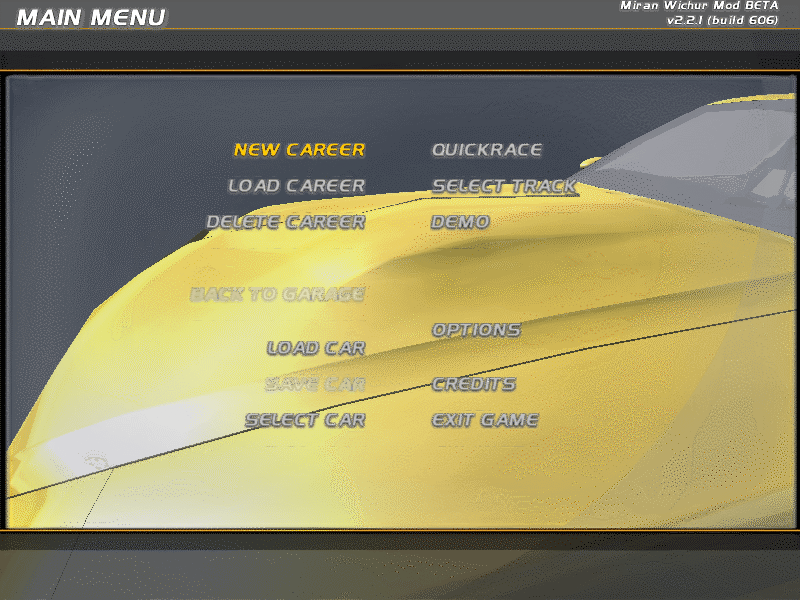
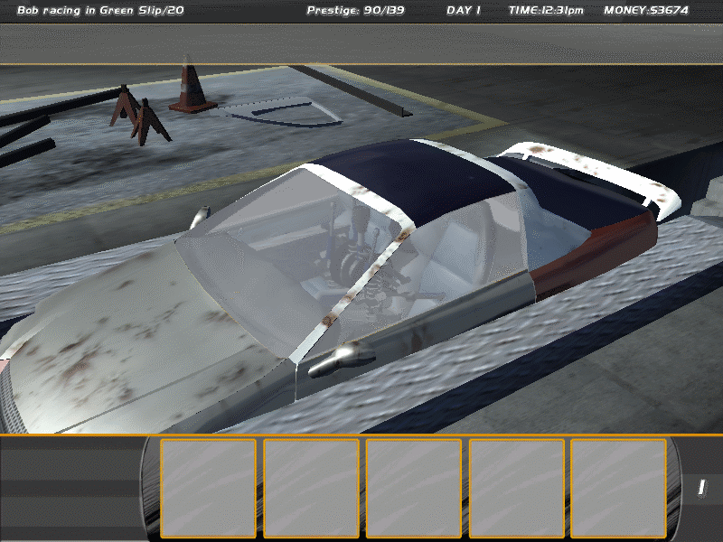
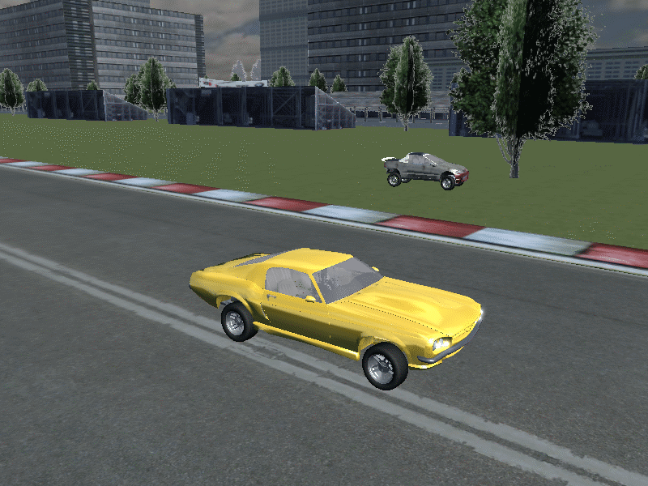

# Race wave: the game renderer adapter (`src/Slrr.Game.Render`)

`Slrr.Game.Render` implements the host's `IRenderer` (`src/Slrr.Game`) on top of `Slrr.Render`. Per host frame it draws what the
shipped scripts describe into an offscreen target: the 3D scenes of every active camera (render instances, cars built from the **live
part tree** with paint and animated wheels, light glows, map geometry streamed around the eye, sky) and then the 2D overlay of every
Osd. It writes PNGs every n frames. It changes no existing project; `Slrr.Render` is used through its public parts only.

Labels: **M** = measured on the shipped data or by running the shipped scripts in the host; **G** = guessed (chosen to fit the data;
needs a trace of the original or a side-by-side screenshot).

```
dotnet build src/Slrr.Game.Render/Slrr.Game.Render.sln -warnaserror
LIBGL_ALWAYS_SOFTWARE=1 xvfb-run -a dotnet test src/Slrr.Game.Render/Slrr.Game.Render.sln     # 27 tests, ~25 s; without GL / game data they pass vacuously
LIBGL_ALWAYS_SOFTWARE=1 xvfb-run -a dotnet src/Slrr.Game.Render/Host/bin/Debug/net8.0/slrr-game-render.dll demo --root . --out out
```

## CLI (`tools/Slrr.Cli/CmdGameRender.cs`, `public static int Run(string[] args, TextWriter o, TextWriter e)`)

```
game-render demo   [--root dir] [--out dir] [--size WxH] [--cull off|all|opaque] [--map archive.rpk]
game-render play   [script.play | --smoke] [--root dir] [--out dir] [--capture-every n] [--size WxH] [--cull ..] [--no-settle]
game-render cull   [--root dir] [--out dir]                       back-face culling measurement (car, city foliage, glass)
game-render stream [--root dir] [--map archive.rpk] [--radius r] [--steps n]   region streaming / memory check over a big map
```

`play` runs a play script of `Slrr.Game` with the adapter attached; `--capture-every n` writes `frame-NNNNNN.png` every n host frames
(frames in between cost nothing). `demo` is the proof sequence described below. `SLRR_GAME_RENDER_DIAG=1` additionally prints the unconsumed
camera/controller commands and the car/camera nodes at the end of `play`.

## Files

| File | Role |
|---|---|
| `GameRenderAdapter.cs` | `IRenderer`: builds one `SceneView` per camera, the overlay, draws, captures (`CaptureNow`, `DrawToImage`, `Benchmark`), `Hooks`, options |
| `Gl/SceneRenderer.cs`, `Gl/FrameTypes.cs` | Renderer over the public `Slrr.Render` GL parts: several views per frame with screen rectangles, per-item texture substitution (paint), glow billboards, per-material cull mode, GPU eviction of streamed chunks, texture budget, overlay |
| `Cars/CarVisualBuilder.cs` | Live `PartState` tree -> draw items: slot placement, paint, wheel animation, lamp state flags, glows, cfg cameras |
| `Cars/CarTelemetry.cs` | `ICarTelemetry` (the seam to Physics), `CarState`, `WheelPose`, `HostCarTelemetry` (derives spin/steer from what the host stores) |
| `Cameras/CameraSources.cs`, `CameraRigs.cs`, `RenderHooks.cs` | `ICameraSource`, `HostCameraSource` (script cameras + camera game objects driven by command strings), chase / cockpit / orbit / free rigs, native hook that records script-camera poses |
| `Maps/RegionMapLoader.cs`, `MapSources.cs`, `GroundSampler.cs` | Region-limited map loader with chunk budget and root filter, `MapStreamer`, `IMapSource` (`HostMapSource`, `FixedMapSource`), brute-force ground height |
| `Scene/HostIds.cs` | Runtime id <-> `ResRef`, node transforms, scene membership, camera basis |
| `Sequence/DemoSequence.cs`, `CullMeasurement.cs`, `StreamMeasurement.cs`, `Report.cs` | The proof sequence and the two measurements |
| `Host/` | `slrr-game-render` console host of the CLI file until the lead wires it |

## How it reads the host (all M unless marked)

* **Scene = subtree of a camera's parent.** A `java.render.Camera` (MainMenu, CarSelect) has `CameraModel.Parent`; a camera game object
  (Garage, CarMarket, City, Track: gametype `RID_CAMERA`) hangs below its scene node (`misc\garage.rpk:0x7A "garage1"`,
  `maps\Addon_Maps\Drag_Track.rpk` root 1). Render instances, cars and lights below that node belong to the view.
* **`RenderRef.create(scene, renderType, name)` is stored swapped** by the Resources area: `ParentId = renderType`, `TypeId = scene`. The
  scripts pass the scene first (`new RenderRef(bgScene, sunType, "menu_bgSun")`). `HostIds.RenderParts` accepts both orders (decided by which
  id is a type 14/13 entry), so a fix in Resources does not break the renderer. Overlay rectangles are render instances below an Osd `Group`
  and are excluded from 3D scenes (`HostIds.InsideOsd`).
* **Cars** are `NativeKind == "car"` instances; their `PartState` tree (`Part.Children`, `MountSlot`, `TypeId`, `Texture`) is the car. The 24
  gametype template chassis below the world root are not cars in a scene. The player's car in the garage has 72 parts incl. 4 rims, 4 tyres,
  brakes, struts; in the real Track flow 79-85 parts.
* **Camera pose of a `java.render.Camera` object is not stored anywhere** (the Ui area keeps a model without a node; `RenderRef.setMatrix`
  needs a node). `RenderHooks` wraps `RenderRef.setMatrix(Vector3, Ypr)` and records it. The MainMenu background camera follows the 28-point
  `bgCamPath` (0.1 m per 2 s).
* **Camera convention**: forward is -Z, up +Y, yaw about Y, pitch about X (same as cfg slots). Test `CameraForwardIsMinusZ_...`: on the 28
  poses of `MainMenuDialog.bgCamPath` (orbiting a car at the origin) the optical axis under this convention points at the car with a mean error of
  21 degrees (the path aims at different car points), against 82 / 98 / 159 degrees for -X / +X / +Z.
* **Menu 3D background**: `MainMenuDialog.show` builds `bgScene`, `bgCam`, a sun light and `new Vehicle(bgScene, prime.rpk:0x6, ..)` only when
  `GfxEngine.openVideo(..)` fails. `Attach` sets `UiEngine.Video.VideoAvailable = false`; the scene then appears with the shipped script's own
  camera path. The sun light is `RenderRef.setLight(14443620, 6579300, 13158600)` on a `maps\skydome.rpk` light entry (read as diffuse, ambient,
  specular: G); the garage `neon` is a local lamp and is not used as the sun.
* **Command cameras** (`render`, `dist`, `move`, `look`, `zoom`, `height`, controller `camera`/`controllable`): read from
  `ResourceEngine.Commands` plus the commands Physics consumed (`GameHost.Natives.PhysicsCommands`, `adapter.ConsumedCommands`). Meaning is **G**:
  `render vp ..` binds (a camera without it is not drawn; the viewport id is 0 in the host, so the full screen is used); `move car off dist` +
  `look` = orbit around the car, direction from the camera's creation position, distance from the verb (Garage: `-3,1.7,-2` around the car, 3.5 m);
  `dist a b` without move/look next to a car = tether to the nearest car within 40 m (the Track's "external track cam", created 6 m behind
  the start); `zoom fov ..` = angle of view; a controller bound to the camera and to a car = chase (written from the verbs, not yet exercised by a started race).
* **Cfg `flags` after a render line are lamp/effect states** (M, from the comments on all shipped car/part cfgs): 1 = BRAKE (54 lines),
  2 = REVERSING (48), 4 = CITY (about 170: lit lamp variants), 16/32 = indicators (IND/IDX/INDICATOR, about 100), 256 = exhaust flame / nitro /
  reverse effect (54), 8 unknown. The renderer draws a line only when it has no flags or one of its bits is on (`CarState`: headlights = 4, brake = 1,
  reversing = 2, indicators = 16/32). Slrr.Render draws all of them, which put a black flame wedge behind every car and lit glow meshes on at all times.

## The gaps the renderer agent listed

| Gap | Result |
|---|---|
| **Car paint colour** | **Found.** The scripts colour a car with `Part.setTexture(resourceId)` (`Descriptor.color` from `GameLogic.CARCOLORS`, applied to every stock part by `Part.addStockParts`; `Vehicle.loadSkin` per part type). `PartState.Texture` holds it. A part's cfg `texture` line equals texture 0 of its render entry and is `cars\textures\default_white.png` on all body parts; the painted ids are `cars\textures\factory_colors\<make>\<name>.png` (Spring_yellow, Devils_eye_red, Nacht, Indigo, Champagner, Murano, used_rusty_Cherry, ... = the `RID_CARCOLOR_*` names): **M** (test `TheMainMenuBackgroundCarIsBuilt...`). Applied (G) by substituting texture 0 of that part's render with the painted file at draw time (per instanced batch, no mesh copies). Used cars from the dealer show mixed panels and rust variants, which is how their parts are painted (parts keep their own texture ids). |
| **Lights / glows (type 13)** | Billboards: a light entry named by a render line gives an additive camera-facing glow at the line's position, colour = `lf_glow_color` read A,R,G,B (G, from headlight 1 .898 .898 .898 white and taillight 1 .5 0 0 red), size from `lf_glow_maxsize` (G, 2 cm per unit), texture = the top-left quarter of `maps\skydome\lensflare\Flares.ptx` (a 256x256 sheet: glare, streaks, discs; the quarter is G), else a soft disc. Drawn only when the line's state is on (see `flags` above). The host has no light state yet: `ForceLights` / `CarState.Headlights`. |
| **Main-menu 3D background scene** | Done (see above): the Prime car in its script-built scene with the script's own camera path. It shows the car very close (the path passes 0.5 m from it). |
| **Back-face culling default** | **Off by default, on for opaque car meshes** (`CullMode.Off` globally, `PaintedItem.BackfaceCull` for cars). Measured below. |
| Wheel rotation / steer / suspension travel | `ICarTelemetry` -> `WheelPose(Spin, Steer, Travel)`; rims, tyres and their children get spin + steer + travel about the hub, brakes steer + travel (G split). `HostCarTelemetry` integrates spin from `node.Vel` over host time and takes steer from `ChassisTelemetry.CurrentSteering1` (M: cell identity, range G); travel needs Physics. |

## Measured results (llvmpipe, 4 shared cores, 800x600; times vary about 2x with machine load)

Proof sequence (`game-render demo`, one host + one more host for the real track flow, 11 s wall, peak working set 0.9 GB for both hosts):

| Stage | Content | Draw calls | Steady frame (8 draws) | First draw (uploads, map load) |
|---|---|---|---|---|
| 1 menu | script camera, bg Prime car (59 parts), overlay 5 sprite runs | 59 | 16 ms | 0.75 s |
| 2 garage | orbit camera, garage1 map root (10 POLY chunks), bought car, overlay | 104 | 32 ms | 1.7 s |
| 3 race (chase) | Drag_Track window of 149 / 196 chunks, 2 cars, glows | 144 | 22 ms | 0.2 s |
| 3b race (other car) | same, side view of the second car | 200 (70 k triangles) | 27 ms | 0.04 s |
| 5 real Track flow | menu -> SELECT TRACK -> Drag Track -> TAKE IT, camera tethered to the car, 142 chunks | 160 | 23 ms | 1.4 s |

Back-face culling (`game-render cull`, 800x600, pixels differing from the double-sided render by more than 6/255 in a channel):

| Scene | Mode | Frame | Differing pixels |
|---|---|---|---|
| Nonus from its cfg | Off / All / OpaqueOnly | 23 / 11 / 13 ms | 0 / 6,914 (1.44 %) / **8 (0.002 %)** |
| City region (trees, buildings, roads) | Off / All / OpaqueOnly | 103 / 65 / 33 ms | 0 / 33,795 (7.0 %) / 2,312 (0.48 %) |

Back-facing triangles from the eye: car opaque 10,888 of 22,041 (49 %), blended 252 of 448; city opaque 22,704 of 57,276 (40 %), alpha-tested
13,909 of 30,212 (46 %), blended 4 of 14. Conclusions: culling alpha-tested (foliage) or blended (glass) meshes visibly changes the picture
(1.4 % of a car frame, 7 % of the city), so those stay double sided. Opaque car meshes are closed and culling is invisible (8 px) and about 45 %
cheaper, so cars use it. Opaque **city** geometry is not safe: 0.48 % of pixels change (building roofs along a skyline edge, small signs: single
sided planes whose winding faces the other way), so the map keeps both sides. The winding itself agrees with the normals (render.md), the
single-sided planes are the exception.

Streaming (`game-render stream`, city, 2,062 m flight in 60 steps, radius 200 m, 480x360): 20 region reloads, at most 121 POLY chunks
held (69 on the GPU), frame 45 ms average, slowest region load 1.0 s, textures 43 MB, working set 431 MB at the end, **peak 539 MB** (the
whole-city render was killed by the OOM killer). Bounds: `RegionMapLoader.MaxChunks` (220, nearest first, test `ChunkBudget...`),
`SceneRenderer.TextureBudget` (640 MB estimated, then the GL texture cache is rebuilt; test `TheTextureCacheIsRebuilt...`), GPU copies of chunks
that left the window are freed (`RetainStatic`, test `StreamedMapChunksAreEvicted...`), the parsed instance forest is kept for the last map only.

## Sample images (`docs/images/race-gamerender-*.png`, 800x600, 160 colours; the dealer car differs from run to run)



`race-gamerender-menu.png`: the real MainMenu Osd (title, version, selected/disabled colours) over the 3D background the script builds. **Looks
right:** the car is the Prime in a Spring_yellow paint, the camera sits on the script's path, text and header are upright. **Wrong or
unverified:** the camera is so close that the car fills the frame and there is no sky or ground visible (the original probably shows
the same close orbit: the path is 0.5 m from the body, but I could not compare); the viewport letterbox (dark bars) is the Osd's, the 3D fills
the screen rectangle of the viewport (viewport left/top meaning is G); no mouse cursor.



`race-gamerender-garage.png`: Garage after buying a used car (play script of Slrr.Game), orbit camera from the Garage script's own start position.
**Looks right:** the car is assembled from its installed parts (glass, interior, seats, strut, mirror, spoiler), painted per part (dark blue hood,
red rear panels in this run), the garage building and props (cone, jack stands) come from the `garage1` root POLY chunks and the render instances,
the HUD texts and the inventory slots are the Osd. **Wrong or unverified:** the car sits at the node position (0,0,0) because nothing settles it
(the original physics would lower it onto the jack), so the body looks sunk into the floor and no wheel is visible from this camera (unverified: where the jack and floor really are); there is no
lighting from the neon lamps (one sun + ambient for everything); glass blending is the Slrr.Render guess (flags2 bit 0x40000000).



`race-gamerender-race.png`: composed race stage (the host cannot start a race with the garage car yet: the placeholder engine "is not in working
condition"). The harness moves the player's car and the main menu's background car (which the scripts leave alive) into a new scene node, drives
them 3 s along Drag_Track with a steering swing, writing node position, velocity and the steering telemetry cell the way Physics will. **Looks
right:** POLY road, kerbs, grass, trees and objects come from the map, the second car (yellow, Prime) rests on the asphalt with its four rims and
tyres at the cfg wheel positions, paint, a headlight glow, the player's car (rust-grey this run) is on the grass in the background. **Wrong or
unverified:** wheel spin cannot be judged from a still (the rims have turned about 200 rad), no suspension travel, no shadows, the second car looks
slightly lifted (tyre radius from the wheel state, no sag), lighting is flat; the car does not get lit headlights from any script state.
The real host flow (`5-track-real`: menu -> SELECT TRACK -> Drag Track -> TAKE IT) renders the Track script's own scene (map root 1, player car at
`posStart` 30,-0.5,-30 lifted onto the road by `SettleCarsOnGround`, the "external track cam" as a chase camera, the navigator Osd): reproduce with
`game-render demo`; it is not committed.

## Interfaces and integration (for the lead)

1. **Solution / CLI.** Add `src/Slrr.Game.Render` and `tests/Slrr.Game.Render.Tests` to `Slrr.sln`; add
   `<ProjectReference Include="..\..\src\Slrr.Game.Render\Slrr.Game.Render.csproj" />` to `tools/Slrr.Cli/Slrr.Cli.csproj` and
   `"game-render" => CmdGameRender.Run(args[1..], o, e),` to `Commands.cs`. Until then `tools/Slrr.Cli` does not compile because
   `CmdGameRender.cs` is already in its folder (same as the other race-wave CLIs).
2. **Host wiring** (what `CmdGameRender` does):
   ```csharp
   var adapter = new GameRenderAdapter(new GameRenderOptions { Root = root, Width = 800, Height = 600, CaptureDir = dir, CaptureEvery = 30, DrawOnlyOnCapture = true });
   var host = new GameHost(new GameHostOptions { Root = root, Renderer = adapter, ExtraModules = [adapter.Hooks] });   // Hooks must be the LAST native module
   adapter.ConsumedCommands = () => host.Natives.PhysicsCommands;                                                    // lets camera verbs that Physics consumed be seen
   ```
   The GL context belongs to the thread that creates the adapter (hidden GLFW window, 3.3 core; `GlHost`): run the frame loop on that thread. An
   app window can later pass its own `GlHost`.
3. **Physics** implements `ICarTelemetry.Get(world, node, chassis, dt) -> CarState` (world matrix override, `WheelPose[4]` spin/steer/travel, lamp
   states) and sets `adapter.Telemetry`; or just writes `ResourceNode.Pos/Ori/Vel` and the chassis telemetry cells as `HostCarTelemetry` expects.
   When Physics lifts cars onto the ground, turn `SettleCarsOnGround` off.
4. **Camera verbs** consumed by Physics are still seen through `ConsumedCommands`; a Physics camera can also replace `adapter.CameraSource`
   (`ICameraSource.Cameras(world) -> CameraBinding[]`: pose, angle of view, rect, layer, scene id).
5. **Map geometry**: `IMapSource.Resolve(world, sceneId, focus) -> MapRequest(archive, rootId, centre, radius)`. The default `HostMapSource` knows
   instance roots that carry POLY geometry: it worked for the garage (root 0x7A of `misc\garage.rpk`) and for Drag_Track in the real Track flow
   (scene node `Drag_Track.rpk:1`); other maps are untested. The World area's `RenderScene` can sit behind this interface; `RegionMapLoader` is the
   Slrr.Render based implementation.
6. **Not wired:** the audio sink, HUD gadgets drawn by `Osd.createObject` (3D icons of an Osd), the mouse cursor, shadows, water (`GroundRef.setWater`),
   particles, traffic and pedestrians, damage deformation (`deformable`/`Part.setMesh`).

## Findings for other areas

* **Resources**: `RenderRef.create` stores `(scene, renderType)` swapped (see above); `getTypeID` / `getParent` therefore answer the other id for render
  instances (inferred from the stored fields, not run). The renderer is robust against either order.
* **Ui**: `java.render.Camera` objects have no node and no pose; the pose of `setMatrix` is dropped. `Viewport` ids are 0 in `render <vp> ..` camera
  commands (`osd.getViewport().id()`), so a camera cannot be matched to a viewport.
* **Host / Physics**: nothing lifts or drops a car, so `Garage` leaves the car at the origin and `Track` at `posStart` y -0.5 (below the road); the
  adapter can settle it for drawing only. Dealer cars (and so the garage car's colours) differ between runs although the VM seed is fixed
  (the menu frame is byte-identical, garage and race frames are not).
* **Render**: its `CfgRenderInfo` ignores the `flags` line after `render` (see above). Its sky dome scale compares the SCX-unit (cm) radius of the
  dome (7,135) with `Camera.Far`, so the dome is drawn at about 500 m radius instead of 50 m (scale 0.105 at far 1500); harmless because it is drawn without depth.

## Open questions

1. Which texture-list slot the painted texture really replaces for parts whose render lists several textures (G: the entry equal to the cfg `texture`).
2. Lamp semantics beyond the comments: is `CITY` (4) "headlights on" or "night"? Do indicator lines (16/32) blink? Which flag drives 8?
3. Light entries: the real glow size units (`lf_glow_minsize/maxsize/offset`), how `lf_texture` sheets are indexed, spot cone (`theta`/`phi`) lighting of the map.
4. Original camera verbs: `move target off dist` (orbit distance vs position), `angle`, `force`, `torque`, `smooth` dynamics, the `viewport` binding, cockpit
   switching (`camera` lines of the car cfg: index 0 = driver, others hood/bumper/wheel/back/mirror; `ext_camera` roles).
5. Original fog and sun for maps (`GroundRef.setFog` values are in `HostNatives.Fog` but unused here; the sky skirt grey is a guess).
6. Why used-car dealer cars differ between runs (host nondeterminism, not the renderer).
