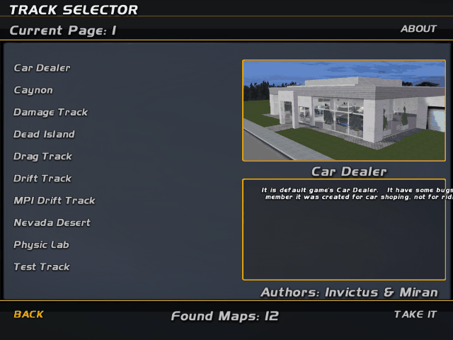
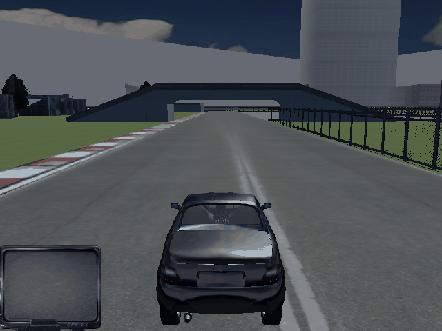
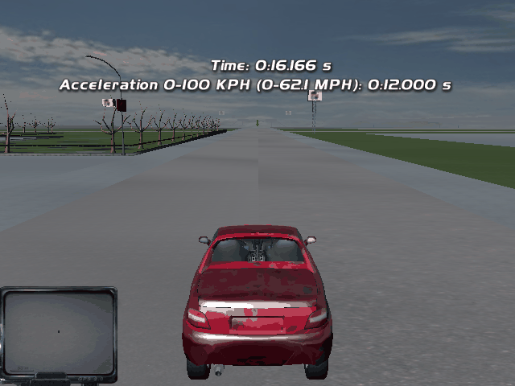

# Race wave: integration (`src/Slrr.Race`)

The five race-wave adapters (map natives, commands, game physics, game audio, game render) composed into one host and
driven by the shipped scripts from the main menu to a car moving on a shipped map. Labels: **MEASURED** = observed by
running our code on the repository data (numbers below come from `race-play` runs and the tests), **GUESSED** = chosen so
the scripts work, not traced in the original. Nothing here is compared with the original game; no parity is claimed.

```
dotnet run --project tools/Slrr.Cli -- race-play --root . --track "Drag Track" --seconds 10
dotnet run --project tools/Slrr.Cli -- race-play --root . --track "Test Track"            # + the TestTrack acceleration round
dotnet run --project tools/Slrr.Cli -- race-play --root . --survey --seconds 5            # every map on a fresh host
LIBGL_ALWAYS_SOFTWARE=1 xvfb-run -a dotnet run --project tools/Slrr.Cli -- race-play --root . --render --audio --out out --capture-every 30
dotnet test tests/Slrr.Race.Tests        # 5 tests; corpus tests pass vacuously without game data, the GL test without a context
```

## Composition root (`RaceHost.Create(root, options)`)

| Piece | Wiring | Why |
|---|---|---|
| Physics | `CommandsPhysicsWorld(MapScopedPhysics(GamePhysicsWorld))` | every `EVENT_COMMAND` is offered to the command engine and to physics; physics steps first, then AI/triggers/cameras |
| Command engine's cars | `CommandEngine.ForResources(res, bridge, bridge)` with `PhysicsVehicleBridge` | cameras, triggers, AI and `getSpeedSquare` read the one simulation; without it the kinematic stand-in would move the same nodes as physics (design choice, not a measured bug) |
| Physics map | `MapWorldsSource` (an `IMapWorldListener` on MapNatives' `MapWorlds`) | the `StaticWorld` the GroundRef natives loaded for `Track.enter` |
| Native modules (order) | host natives → `MapNativesModule` → `PhysicsNatives` → `CommandNatives` → render `Hooks` | MapNatives needs `GameHost.Resources` (new `GameHostOptions.ModuleFactories`); CommandNatives chains getInfo so it follows HostNatives and only fills Vehicle natives PhysicsNatives did not register; Hooks must be last |
| Engine model | `GameHostOptions.Dyno = new ExeDynoCalculator()` | Slrr.Physics' exe-measured cycle model instead of the host placeholder |
| Audio | `RaceAudioSink(GameAudioSink, physics)`: attaches every bound chassis (`AttachChassis` + `PhysicsAudioTelemetry`) | switch `RaceHostOptions.Audio`; WAV written on dispose |
| Render | `GameRenderAdapter` with `Telemetry = PhysicsRenderTelemetry` (wheel spin/steer/travel, brake/reverse lamps), `SettleCarsOnGround = false`, `ConsumedCommands = host.Natives.PhysicsCommands` | switch `RaceHostOptions.Render`; GL context on the calling thread |

`CommandsPhysicsWorld` moved from `tools/Slrr.Cli/CmdRace.cs` into `Slrr.Race` (the Commands test project now references it).

## End-to-end run (MEASURED, `RaceScenario`, CLI `race-play`, test `TheBoughtUsedCarDrivesOnDragTrackThroughTheInputLayer`)

Boot → MainMenu (3.03 s game time) → the embedded `smoke-garage.play` up to the catalog part (NEW CAREER, name, used-car
dealer, buy the first car) → Garage **Choose Track** (passes `Vehicle.isDriveable`) → TrackSelect → map → TAKE IT →
`Track.enter` ran to its end → 2 s settle → **keyboard Up held** (DIK 200, mapped by the shipped control file to
`AXIS_THROTTLE`) for N seconds → assertions from VM-visible state.

Drag Track, 10 s of throttle (headless, bit-identical in every run, also with render+audio on):

| Quantity | Value |
|---|---|
| Car | `java.game.cars.Duhen_SunStrip_1_5_DVC`, 72 parts, 1203 kg (mass sum GUESSED), money 20000 → 3999 |
| Engine (script fields after `calcDyno`) | maxTorque 130.8 N m @ 2750, Compression 10.24 (min 5.84, max 14.60), RPM_limit 7500 |
| Start (physics, map `Drag_Track.rpk`) | (30.0, 0.64, -30.0), script `posStart` (30, -0.5, -30) snapped to the road |
| After 10 s | moved 128.8 m along -Z, 87.1 km/h, 3rd gear (auto box), rpm max 7123 |
| Script view | `player.car.getSpeedSquare()` run in the VM = 585.7 m²/s² (= 24.2 m/s = 87.1 km/h); instance node position moved with the car |
| Wheels on the ground | 100 % of frames × wheels |
| Script thread errors / missing natives | 0 / 0 |

TestTrack acceleration round (test `TestTrackAccelerationRoundIsTimedByTheScriptsOnTheSimulatedCar`): the harness puts the
car at round 0's start trigger (0, 0, -1461.78) facing `startdir` 3.14 by writing the instance node (what a script
`setMatrix` does; physics snaps it to the ground), waits 3 s for the script's timer, then holds Up. The **script's own**
fields of `player.car`: **1/4 mile 18.200 s, 1 mile 45.699 s, 0-100 km/h 12.000 s**, max 174.0 km/h (the car's top speed in
5th at the 7500 rpm limit); 0-200 never reached. The script prints them on its HUD (image 3). The triggers fire through
the command engine (EVENT_TRIGGER_ON/OFF with the car id). That 12.000 and 18.200 are multiples of 0.2 s is noted, not
explained (GUESS: the script's polling). These are our physics model's numbers, not the game's.

### Every track-selector map (MEASURED, `race-play --survey --seconds 5`, one fresh host per map)

| Map (class) | entered | moved m / 5 s | max km/h | wheels grounded | thread errors | enter ms | drive ms/frame | physics ms/step |
|---|---|---|---|---|---|---|---|---|
| Car Dealer (DealerTrack) | yes | 9.8 | 25.0 | 96 % | 0 | 267 | 1.94 | 0.071 |
| Caynon (CaynonTrack) | yes | **0.1** | 1.9 | 97 % | 0 | 207 | 2.06 | 0.066 |
| Damage Track | yes | 18.9 | 32.3 | 96 % | 0 | 422 | 1.65 | 0.054 |
| Dead Island | yes | 25.1 | 40.6 | 99 % | 0 | 218 | 1.67 | 0.089 |
| Drag Track | yes | 32.1 | 47.4 | 100 % | 0 | 340 | 2.48 | 0.065 |
| Drift Track | yes | 35.5 | 50.1 | 100 % | 0 | 323 | 1.93 | 0.063 |
| MP1 Drift Track | yes | 32.2 | 47.5 | 100 % | 0 | 195 | 1.72 | 0.052 |
| Nevada Desert | yes | 31.9 | 47.1 | 100 % | 0 | 499 | 2.36 | 0.061 |
| Physic Lab | yes | 35.0 | 54.7 | 100 % | 0 | 340 | 2.54 | 0.066 |
| Test Track | yes | 21.4 | 36.0 | 100 % | 0 | 469 | 2.32 | 0.058 |
| Top Gear Track | yes | 32.1 | 47.4 | 100 % | 0 | 402 | 1.89 | 0.058 |
| Valo City (Valocity) | yes | **153 (falling)** | 204.5 | **0 %** | 0 | 874 | 3.00 | 0.066 |

**10 of 12 maps can be driven.** Caynon: the car sits at (0.3, 9.5, -20.5) with all wheels on the ground while the
automatic box shifts up to 5th at 0-2 km/h, i.e. the driven wheels spin without traction (cause not found; GUESS: the
surface mapping of the 'Groung' material or the start pose). Valo City: see the blockers below.

### Costs (MEASURED, 4 shared vCPUs, ±30 % between runs)

| Stage (headless, Drag Track run) | host frames | wall | per frame |
|---|---|---|---|
| boot to MainMenu | 91 | 0.79-1.3 s | 8.7-14 ms |
| new career + used-car purchase | 396 | 2.0-2.9 s | 5-7 ms |
| Choose Track → TAKE IT → Track entered (map world built) | 68 | 0.29-0.59 s | 4-9 ms |
| driving (VM + 4 physics steps at 120 Hz + commands + audio off) | 301 | 0.58 s | 1.9 ms |
| physics alone, 1 car incl. map collision | | | 0.06-0.13 ms per 1/120 s step |
| whole scenario | | 4.7 s wall for 30 s of game time | |

With render (640x480, llvmpipe) and audio on: the drive costs 6-7 ms per host frame averaged (a PNG every 30 frames);
a drawn track frame is 22 ms mean / 58 ms max on Drag Track (4 views, 109-127 draw calls, ~35 k triangles) and 32 ms mean
on Test Track (~52 k triangles); boot/career frames 16-25 ms (menus draw the Osd and the 3D menu car). Whole run 12.7 s
wall. The physics adapter ran 0.084-0.14 ms/step in these runs.

## Integration bugs found and fixed (root causes)

1. **"You can't drive this car because the engine is not in working condition."** (MEASURED) The full Garage warning read
   "... not in working condition. the static compression is too low in the engine. At least 5.8:1 is needed".
   `EnginePart.isDriveable` returns that when `Block.isDynoable()` fails; it compares `dynodata.Compression` with
   `minCompression`. `Compression` (and `Displacement`) are written by the native `DynoData.calcDyno` in the exe
   (0x46aefd/0x46af10, already listed as finding 2 in docs/phase4/physics.md), but the parts layer's `DynoCurve` had no such
   fields, so `Compression` stayed 0 with every dyno model (the placeholder too: what the render agent saw). Fix (parts
   layer + both dyno models): `DynoCurve.Displacement/Compression` (optional), `PartsNatives.calcDyno` writes them,
   `ExeDynoCalculator` passes `EngineCycleModel.Displacement/Compression`, the placeholder computes the same geometry.
   After: Compression 9.78 / 10.24 for the two SunStrips, the garage lets the car out. Unit test `CalcDynoReportsCompressionAndDisplacement`.
2. **The car stayed parked on the track** (MEASURED). `Track.lockCar` sends `reset; reload` as the player car's last verbs
   and nothing sends `start` afterwards (Track.class); the physics adapter made `reset` hold the car. Fix (physics, one
   verb): `reset` puts the car at rest, upright and on the ground but keeps its run state; cars are still held with `stop`
   (City grids: `reset; setMatrix; stop; idle ... start`). GUESSED semantics, chosen from the scripts' use.
3. **Keyboard input never reached the car** (MEASURED: `AXIS_THROTTLE` mapped to `dev-3/ax200`, value 0 with Up held).
   `ControlSet.load` reads `save/controls/active_control_set` and matches its device names ("SysKeyboard", "SysMouse", two
   pads, MEASURED from the file) with `==` against `Input.getDeviceName`. Two causes: the Ui area named device 0
   "Keyboard", and `getDeviceName` returned a fresh String while `File.readString` returns interned ones (the System area
   documents this exact hypothesis), so no name ever matched and every mapping got an unknown negative device. Fix:
   device 0 = "SysKeyboard" (Ui; test updated) and a host native wrapper that returns the name from the System intern
   pool (Slrr.Game `HostNatives`, listed in its gaps). After: `dev0/ax200` → throttle 1.0.
4. **Ghost cars from the dealer on the race map** (MEASURED). The physics adapter keeps every chassis it ever bound; the
   dealer's other cars (at the dealer scene's origin, one detached with parent 0) stayed in the scene as held invisible
   bodies at (0, y, 0) of whatever map was loaded next. On Test Track the acceleration run hit them at 174 km/h under the
   bridge at z = -3.5 (48.3 → 23.4 m/s in one frame, car launched to y 4.3 and wedged; the same with chassis-vs-map
   collision switched off, so it was car/car), the 1 mile trigger was never reached. Fix (glue, `MapScopedPhysics`):
   before each step remove cars whose instance is gone, detached, or not below the current map (`MapWorlds.MapOf`); a car
   is bound again by its next verb. After: the round finishes (1 mile 45.699 s).
5. **Composition gaps** (no behaviour bug): MapNatives needs the host's `ResourceEngine`, created inside the `GameHost`
   constructor → `GameHostOptions.ModuleFactories` (registered after `ExtraModules`, in order); `CommandsPhysicsWorld`
   lived in a CLI file → moved to `Slrr.Race`.

Changes outside `Slrr.Game`, `Slrr.Race`, `tools/Slrr.Cli`: `Slrr.Engine.Parts` (`DynoCurve`, `PartsNatives.calcDyno`),
`Slrr.Physics` (`ExeDynoCalculator.Calculate`), `Slrr.Game.Physics` (`reset` verb), `Slrr.Engine.Ui` (`InputState.Devices`
+ its test), `tests/Slrr.Engine.Commands.Tests.csproj` (reference to Slrr.Race), docs/race/game-physics.md (reset row).

## Images (render + audio run, llvmpipe 640x480, quantised to 160 colours)



`race-run-1-trackselect.png` (Drag Track run, host frame 510): TrackSelect after Garage → Choose Track. **Right:** the
script's own Osd (12 maps, page 1, "Car Dealer" preview picture and description, TAKE IT / BACK). **Unverified:** fonts and
layout are the Ui/Render areas' reading; the description box text is clipped at the right.



`race-run-2-dragtrack.png` (Drag Track, ~9.5 s of throttle, 85 km/h): chase camera behind the bought car on the strip,
kerbs, grass, trees, fence, the overhead bridge and the buildings from the map. **Right:** car on the road on four wheels
(physics), painted per part, camera from the scripts' `dist`/controller verbs. **Wrong or unverified:** the
navigator (bottom left) is an empty frame (`Navigator.updateNavigator` is a no-op); flat lighting, no shadows; the
paint differs between runs (grey here, red/yellow in other runs: the dealer's cars are not reproducible although the VM
seed is fixed); wheel spin/steer cannot be judged from a still.



`race-run-3-testtrack-accel.png` (Test Track acceleration round): the TestTrack script's HUD "Time: 0:16.166 s" and
"Acceleration 0-100 KPH (0-62.1 MPH): 0:12.000 s", i.e. the script timed our simulated car. **Right:** the timing HUD,
start-line lights and signs, the straight. **Wrong or unverified:** the far scenery is sparse grey/green (map streaming
radius 280 m and fog are the render area's guesses); same lighting caveats.

WAV (MEASURED, same run): 30.3 s at 44.1 kHz stereo 16-bit, silent for the first 3 s, then menu sound and the engine:
the player car got 5 engine-sample voices from its Parts tables, driven up to table rpm 7124. Between 0.02 % and 0.23 % of
the samples in every second from 3 s on are at full scale (clipping); the mixer gains (`MasterGain 0.5`, music) were not
tuned here. Not committed (5 MB).

## What still blocks a complete race (finish line, opponents, lap timing, results)

1. **The track-selector maps are free-ride maps.** Their classes (e.g. `Drag_Track`, a 54-line decompiled listing) contain no Bot,
   Round, RaceDialog or AI verbs (MEASURED, grep of the decompiled classes); only TestTrack has timed rounds (working, above).
   Races with opponents, a finish and a results dialog (`RaceDialog`) are in `City` (day/night races: `new Bot`,
   `AI_BeginRace`) and `ROCTrack` (MEASURED from the decompiled classes).
2. **Valo City is not drivable** (MEASURED): the script puts the car at the club garage exit `posGarage[0]`
   (-278.518, 9.8, 1033.0); `world height maps/city.rpk -278.5 1033` finds **no ground** there, so the car free-falls
   (0 % wheels grounded, held by the physics fall guard at y -163.7). The screen also shows a WarningDialog and the player
   controller had no `AXIS_THROTTLE` mapping in that run. Cause not found (GUESS: that district's ground is in another
   archive/instance that Slrr.World does not load for `maps\city.rpk`).
3. **ROC is out of reach of a fresh career**: `GameLogic.ROC_ENTRYFEE` = 100000 (MEASURED), the career has 3999 after the
   purchase. Not tried with an edited save.
4. **AI opponents**: the path exists (command engine brains → `PhysicsVehicleBridge.SetInput` → physics car input, steering
   sign converted) but no shipped race that creates a bot was reached, so it is untested end to end. AI route following is a
   straight line to the target (GUESSED, docs/race/commands.md), traffic is cruise-straight.
5. **Lap timing / results**: `RaceDirector` route/lap telemetry exists (GUESSED, not an exe feature); the scripts' own lap
   and result logic (City, ROCTrack, `RaceDialog`) was never reached. The finish line of TestTrack (1 mile trigger) works.
6. **Caynon** wheels spin without traction (above). Other gaps seen: navigator minimap empty, paint of dealer cars not
   reproducible, `EVENT_COLLISION`/damage from impacts not wired (physics has the impacts, the event payload is unknown).
