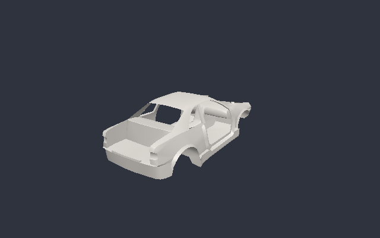

# SCX viewer spike (`src/Slrr.Viewer`)

Phase 2 spike: a minimal OpenGL 3.3 core viewer for one `.scx` file. It uses Silk.NET (Windowing, OpenGL and
Input 2.22.0) with an orbit camera and a directional light, and can render one frame headless to a PNG.



## Usage

```
dotnet build src/Slrr.Viewer/Viewer.sln
slrr-viewer <mesh.scx> [--screenshot out.png] [--size WxH] [--yaw rad] [--pitch rad] [--wireframe]
```

Interactive controls: left-drag orbits, the wheel zooms, `W` toggles wireframe, `R` resets the camera and
`Esc` quits. With `--screenshot`, the viewer opens a hidden window, renders one frame into an FBO, writes the
PNG and exits. Exit codes: 0 on success, 1 when the mesh does not load, 2 for bad arguments, 3 when GL or
windowing fails.

Headless on Linux (this is how the image above was made):

```
LIBGL_ALWAYS_SOFTWARE=1 xvfb-run -a slrr-viewer cars/racers/Nonus_data/meshes/chassis.scx --screenshot out.png
# GL: 4.5 (Core Profile) Mesa 25.2.8 / llvmpipe (LLVM 20.1.2, 256 bits)
```

## Architecture

| File | Role | GL? |
|---|---|---|
| `MeshData.cs` | Turns an `ScxFile` into GPU-ready arrays: an interleaved `float[]` (pos xyz, normal xyz; 24 B stride), a `uint[]` index list rebased across meshes, `SubMesh` ranges per SCX mesh, and bounds, centre and radius | no |
| `OrbitCamera.cs` | Yaw, pitch (clamped) and distance (clamped) around a target; `Frame(center, radius)`; System.Numerics view and projection | no |
| `PngWriter.cs` | Dependency-free RGBA PNG encoder (`ZLibStream` + CRC32) that can flip the bottom-up rows from `glReadPixels` | no |
| `ViewerOptions.cs` | CLI parsing | no |
| `MeshRenderer.cs` | One VAO, VBO and EBO, a GLSL 330 program, and a single `glDrawElements` | yes |
| `OffscreenTarget.cs` | FBO with RGBA8 + Depth24 renderbuffers, and `ReadPixels` | yes |
| `Program.cs` | Silk.NET window, input and the render loop, plus screenshot mode | yes |

The four pure classes are covered by `tests/Slrr.Viewer.Tests` (19 xunit test cases, no GL needed). They include a
corpus test that converts every loose `.scx` file: 3,224 files, 5,568 meshes and 1,778,800 vertices in about
2 s. One mesh is skipped because it is empty. 1,272 normals had to be generated because those meshes have
none.

`MeshData` treats its input as untrusted. A mesh is skipped and counted, never thrown, when an index is out of
range or a position is not finite. A trailing partial triangle is dropped. Missing, zero-length or NaN
normals, or a normal array whose count does not match, are replaced by area-weighted smooth normals. It reads
vertices through `ScxVertexBuffer.Position/Normal`, the same accessors the glTF exporter uses, so the viewer
and `dump-scx --gltf` agree on the geometry.

Rendering choices made because the SCX facts are not yet verified (see `formats/scx.md`):
- Handedness and winding are unknown, so back-face culling is off. The fragment shader flips each normal to
  face the viewer, which gives two-sided lighting. Once winding is known, enable culling and drop the flip.
  The data is probably D3D left-handed and is drawn here as-is in a right-handed GL view, so the model may
  appear mirrored.
- Units look like centimetres (the chassis is about 410 units long). The camera frames the bounding box, so
  units do not matter for the viewer.
- Materials, UVs and textures are not used yet. The next step is to decode the type 0 material chunk and
  load PTX textures, then draw each `SubMesh` with its own material.

## Renderer backend decision data

What the spike measured (Silk.NET only):
- NuGet restore of `Silk.NET.Windowing`, `Silk.NET.OpenGL` and `Silk.NET.Input` 2.22.0 worked through the
  proxy. They pull in `Silk.NET.GLFW` and `Ultz.Native.GLFW`, which ship native GLFW for win-x64/x86/arm64,
  linux-x64/arm/arm64 and osx-x64/arm64. The Debug output is 6.1 MB.
- The build passes under the repo's `TreatWarningsAsErrors` + `AnalysisLevel=latest`. It needs only
  `AllowUnsafeBlocks` for pointer-style GL calls.
- The API is a thin 1:1 binding to GL. Vertex upload, shaders, FBOs and readback took about 400 lines (renderer, FBO, window loop) with no
  engine concepts to work around. System.Numerics matrices upload untransposed.
- Headless: GLFW has no surfaceless path by default. With Xvfb, a hidden window and Mesa llvmpipe, GL 4.5
  core works and renders in well under a second. Without a display, GLFW fails cleanly with
  `65550: Failed to detect any supported platform`, which the viewer reports as exit code 3. This sandbox has
  no `libEGL`, so I did not try EGL or surfaceless rendering. In CI, use `xvfb-run` + llvmpipe, or add an EGL
  context later.
- The same family has `Silk.NET.Vulkan`, `Silk.NET.Direct3D11` and `Silk.NET.Direct3D12`, so the windowing
  and input code carries over if the production backend moves off GL. Silk.NET 3.0 is under development and
  will break APIs, so pin 2.x and keep GL calls inside `Slrr.Render`.

Stride and MonoGame were not spiked here. The notes below come from their documentation and package feeds as
of 2026-10, not from builds in this repo. Current NuGet versions: Stride.Engine 4.4.1,
MonoGame.Framework.DesktopGL 3.8.6, and Veldrid 4.9.0 as another thin option.

| | Silk.NET + own renderer | Stride | MonoGame |
|---|---|---|---|
| x64 / .NET 8 | yes (built and run here) | yes | yes |
| Scene model | none; we own it, which matches SCX meshes, `compound` CFG parts and TUFA-driven scenes | its own entity/component system and asset database; the game's runtime-built scenes would fight it | none beyond `Game`/`GraphicsDevice` |
| Content pipeline | none needed; we load SCX/PTX directly (already parsed in `Slrr.Formats`) | asset compiler and editor built around imported FBX/glTF; loading raw game formats at runtime bypasses most of it | MGCB content pipeline (optional; raw loading possible) |
| APIs | GL, Vulkan, D3D11/12 bindings | D3D11/12, Vulkan, GL | D3D11 (WindowsDX), GL (DesktopGL); newer backends in preview |
| Shaders | raw GLSL/HLSL/SPIR-V, our choice | SDSL (Stride shader language) | MGFX (HLSL subset), effect-based |
| Headless testing | Xvfb + llvmpipe proven here | heavier runtime; not tried | DesktopGL via SDL, Xvfb probably works; not tried |
| Risk | we write the renderer (materials, shadows, post) ourselves | big dependency, editor-centric workflow | older fixed effect model, shader limits |

Recommendation (unchanged from the plan, now with evidence): **Silk.NET + own renderer**. Keep the backend
behind `Slrr.Render` and start on GL 3.3 core, which runs headless in CI with llvmpipe. Revisit
Vulkan/D3D11 once material and post-processing work needs it. The pure `MeshData` and `OrbitCamera` layer
does not depend on the backend.

## Not yet verified

- Interactive mode (window, mouse and keyboard) was built but never run: this sandbox has no display or input
  devices. Only the hidden-window screenshot path was executed.
- Windows and macOS were not run. The GLFW natives are in the package, but macOS needs the core 3.3
  forward-compatible context, which is requested.
